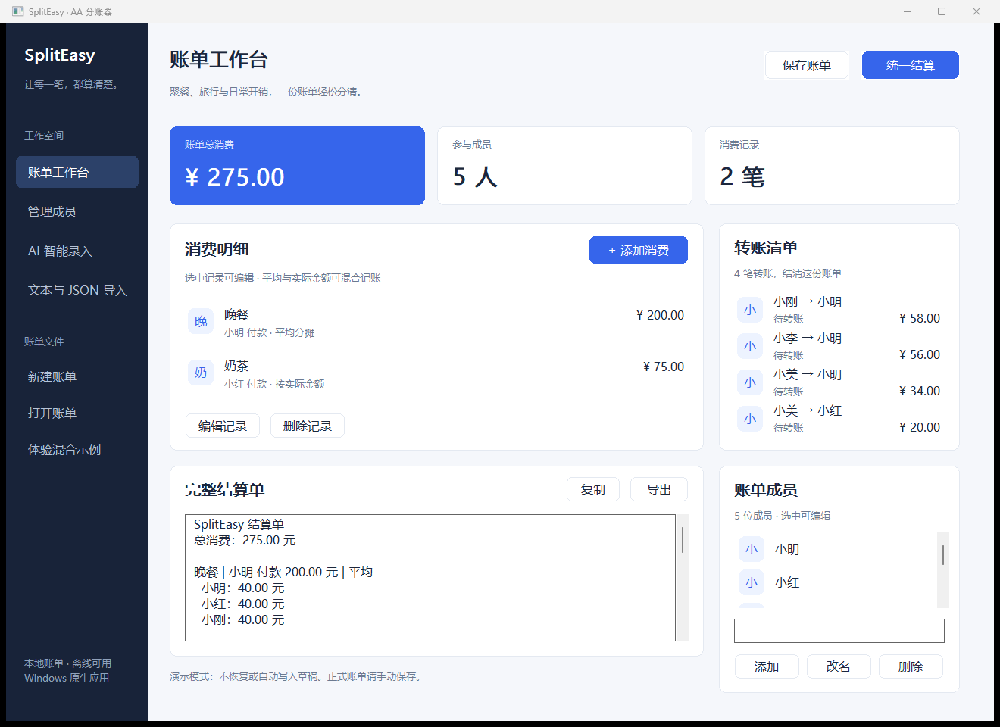

# SplitEasy · MoonBit AA 分账应用

MoonBit Native + Windows 原生控件，MIT 开源。平均与按实际金额消费可以混合记账，最终统一生成结算清单。Windows 程序不使用 HTML、WebView 或浏览器。

**无需下载，直接在线使用**：[打开 SplitEasy · GitHub Pages](https://william206920.github.io/Splict-easy/) · [Vercel 备用入口](https://spliteasy-online.vercel.app)。成员、消费、文本/JSON 导入、整数金额与结算复用 MoonBit 核心，在浏览器内运行；Windows 原生程序继续提供。

共享 Kimi K2.6 通过 Vercel 服务端提供，密钥不进入 GitHub Pages 或浏览器，访客无需填写 Key；两个入口共用每 IP 每小时 10 次、全站每天 100 次的额度。AI 解析需同意外发并逐笔确认。两个站点的浏览器草稿各自保存，切换入口前可导出 JSON 再导入。[GitHub Pages 部署方式](docs/GITHUB_PAGES.md) · [Vercel 与真实模型验证](docs/VERCEL_DEPLOYMENT.md)。

**Windows 原生版当前为 0.9.1 开发预览：增加独立成员管理、文本/JSON 导入指南与示例，修复页面切换输入丢失和账单替换保护。原生 GUI/CLI 真实模型演示和用户 Windows 桌面实测仍待验收；网页版真实调用不代表桌面端已验收。**

- [界面优化、同类产品参考与验证](docs/UI_REDESIGN.md)

- [整体验证与剩余验收](docs/VERIFY_CURRENT.md)
- [各阶段源码与提交](../../commits/main)
- [Windows CI 与构建产物](../../actions/workflows/native-windows.yml)
- [下载 Windows 0.9.1 首个公开版本](https://github.com/William206920/Splict-easy/releases/tag/v0.9.1)（含安装器、便携包、SHA256 校验和）
- [成员页、导入填写示例与修复记录](docs/MEMBERS_IMPORT_FIX.md)
- [版本说明与验证范围](docs/RELEASE_NOTES.md)
- 原生程序截图由 Windows CI 的 --demo 示例模式生成，随预览发行提供；不包含真实账单或 Key。
- [操作演示](docs/demo.md) · [AI 验证说明](docs/AI_DEMO.md)

旧网页代码已按用户要求移出 main，Git 历史保留。本次在线版是基于当前 MoonBit 核心的新入口，重新验证，不沿用旧网页测试结论。



以上为真实原生程序运行截图，使用内置示例账单；[查看消费、AI 和导入页面](docs/UI_REDESIGN.md)。

## 下载、安装与使用

从 [GitHub Releases](https://github.com/William206920/Splict-easy/releases/tag/v0.9.1) 下载 Windows x64 文件：

- `*-Portable.zip`：完整解压后双击 `SplitEasy.exe`。
- `*-Setup.exe`：按当前用户安装，可从开始菜单启动，也可卸载。
- `SHA256SUMS.txt`：对照 `Get-FileHash <文件> -Algorithm SHA256`。

运行不需要 MoonBit、Python、浏览器、服务器或账号。程序未做商业代码签名，实际 Windows 10/11 显示、DPI、输入法与系统提示仍需用户实测。自动验证环境为 Windows Server 2025 x64。

快速体验：点击“混合示例”→确认替换→“统一结算”。得到总消费 275 元，小明应收 148 元，小红应收 20 元；四笔转账为：小刚→小明58、小李→小明56、小美→小明34、小美→小红20元。

手动记账：

1. 点击左侧“管理成员”进入独立页面，输入姓名并添加。选中成员后可改名或删除，并查看关联消费数量；被消费引用的成员必须先处理关联消费。
2. 添加消费，填写名称、付款人和总额。
3. 平均模式勾选人员；实际金额模式逐人填金额，不承担者明确填 0；表单保存时零份额按未参与处理，不产生多余人员引用。核心仍兼容导入的显式零份额。
4. 实际份额合计不符时不能保存。付款人可以不参与。
5. 重复添加，统一结算，复制或导出报表。

日期可空；填写时使用有效 `YYYY-MM-DD`。姓名不能包含空白、冒号或 `@ ! =`。

## 保存、草稿与隐私

正式账单是版本化 UTF-8 JSON 文件。打开/导入先校验并预览，确认后替换当前账单。保存采用临时文件同步后替换，失败不损坏旧文件。

自动草稿位于 `%LOCALAPPDATA%\SplitEasy\draft.json`。启动恢复有效草稿；损坏或无效 UTF-8 草稿会保留，自动保存暂时关闭，避免覆盖。新建账单会询问并重置草稿。关闭或打开其他账单前提示处理未保存更改。

普通记账、保存和计算完全离线，不主动上传账单，无追踪或账户服务。AI 只有主动启用并确认后才向所选模型服务发送账单。密钥只在当前会话或显式环境配置中使用，不写入账单、草稿、日志或仓库。卸载保留用户账单和草稿。

## 高级文本

```text
人：小明 小红 小刚 小美
小明 300 晚餐
小红 120 加菜
小刚 40 饮料 !小红
```

默认全员平均；`@` 指定、`!` 排除、`=` 实际份额，同笔不混用。例如：

```text
人：小明 小红 小刚 小美 小李
小明 200 晚餐
小红 75 奶茶 =小明:12 小红:15 小刚:18 小美:14 小李:16
```

高级输入界面也接受账单 JSON。示例在 [examples](examples)。错误保留原始行号，支持 BOM 与 Windows 换行。

不熟悉语法时，在“文本与 JSON 导入”中点击“文本示例”或“JSON 示例”后照着修改，右侧有简易说明。“当前账单”可填入当前账单的 JSON 模板；这些按钮只改变编辑框，核对预览并确认替换后才改变账单。文本金额单位是元，JSON 的 `amount_cents` 是整数分，例如 `1250` 表示 12.50 元。

## CLI

```powershell
./spliteasy-cli.exe check -f examples/bills_dinner.txt
./spliteasy-cli.exe split -f examples/bills_mixed.txt
./spliteasy-cli.exe split -d examples/ledger_mixed.json --json
./spliteasy-cli.exe split -f examples/bills_mixed.txt -o out.md
./spliteasy-cli.exe split -f examples/free_mixed.txt --ai
```

`-f/-d` 互斥，默认 Markdown，`--json` 输出报表 JSON，`-o` 原子写文件。错误写 stderr，失败退出 2，成功退出 0。非 AI 不读取模型配置或联网。`--help` 查看用法。

## AI 模式

应用内点击“AI 解析”，填写兼容 Chat Completions 服务的 Base URL、API Key、模型名称和自然语言。

- Base URL 为 API 根，例如 `https://你的服务/v1`，程序追加 `/chat/completions`；已经填写完整端点时不重复追加。
- 公网服务使用 HTTPS。本地测试允许 `http://127.0.0.1:端口/v1`。
- **第一次确认**：核对目标服务、模型与当前输入后发送。
- 后台请求，不阻塞窗口。可以取消，已经发送的内容可能仍被服务端处理。
- MoonBit 严格校验模型结构、金额、份额与歧义。错误或缺信息时要求补充，不结算。
- **第二次确认**：逐笔核对预览，再确认替换并结算。取消不修改原账单。

CLI 仅在 `--ai` 时读取 `MOONBIT_BASE_URL`、`MOONBIT_API_KEY`、`MOONBIT_MODEL`。提示和预览到 stderr，stdout/输出文件只包含最终报告。输入 `yes` 才确认，无输入默认取消。密钥请在本机配置，不要提交仓库或发到聊天中。

AI 只负责解析；全部金额、尾差、净额和转账由 MoonBit 核心计算。结构校验无法发现所有语义误解，必须人工核对。当前 AI 请求的总超时为 30 秒；已有模拟测试，真实服务和模型信息尚未配置验收，见 [AI_DEMO](docs/AI_DEMO.md)。

## 算法与数据

金额是 Int64 整数分，`0.29` 元直接转成 29 分；不做浮点金额计算。平均分摊的余数分给名单顺序最后的人。每人净额=已付−应承担，正数应收，负数应付。

每轮重新选择最大债权人与最大债务人，同额按名单顺序；尽量减少转账，不保证全局最少笔数。测试验证守恒、正金额、无自转账、回放归零和确定顺序。

JSON 金额写成整数分数字记号；自有账单解析器直接读取原始整数字面量，不经过浮点。第三方工具应使用支持大整数的解析器。账单格式 `schema_version=1`，报表格式 `report_version=1`，用途不同。

## 构建与验证

固定工具链见 `toolchain.version`。Windows 源码构建需要 MoonBit、MSVC C++ 桌面工具和 Windows SDK；打包需要 Inno Setup 6.7+，集成脚本使用 Python 3。用户运行发行包无需这些工具。

```powershell
$env:PATH = "$env:USERPROFILE\.moon\bin;$env:PATH"
./scripts/build-windows.ps1 -Smoke
./scripts/package-windows.ps1
./scripts/verify-installer.ps1
./dist/SplitEasy.exe
```

原始命令：

```text
moon fmt --check
moon check --target native
moon test --target native
moon test --target js
moon build --target native --release
python scripts/verify_cli.py <CLI 路径>
```

Linux 可编译核心和配套 CLI，原生 UI 明确拒绝运行；原生 AI 网络传输目前针对 Windows。JS 目标同时用于核心一致性测试与 Vercel 在线版，浏览器控制和服务端策略也由 MoonBit 实现。

Windows CI 还运行真实控件操作、UTF-8 原子文件、CLI 黄金、HTTP 本地模拟、异步 AI 预览、安装/重复安装/卸载和安装后 GUI/CLI 检查。记录见阶段报告及最终验收说明。

## 已知限制与开源

- 单币种人民币、一笔一个付款人；不支持退款负金额、账户同步、支付接口或多设备协作。
- 桌面账单最多 200 人、5000 笔，超限原子拒绝，便于保持系统控件可用。
- 当前为预览版，真实模型演示、用户 Windows 10/11、输入法、视觉布局和 DPI 人工验收待完成。
- 安装器未签名。
- 项目代码 MIT；MoonBit core/runtime 等第三方许可见 [third_party](third_party) 和 [NOTICE](NOTICE.md)。
