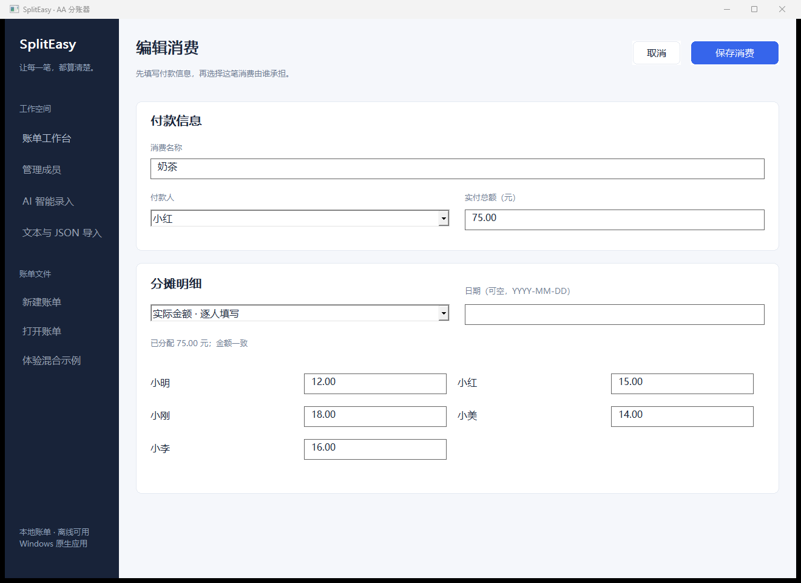
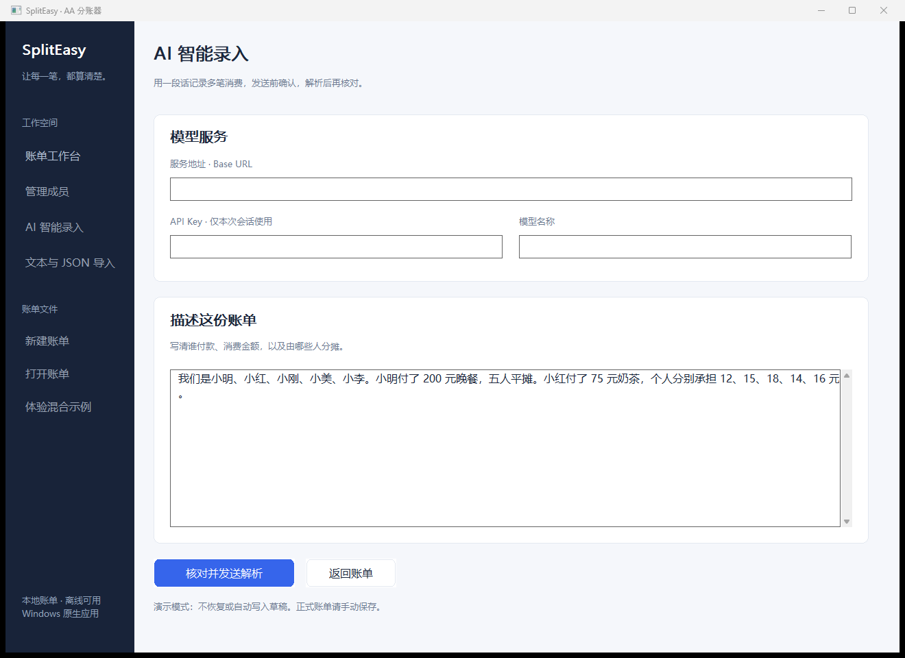
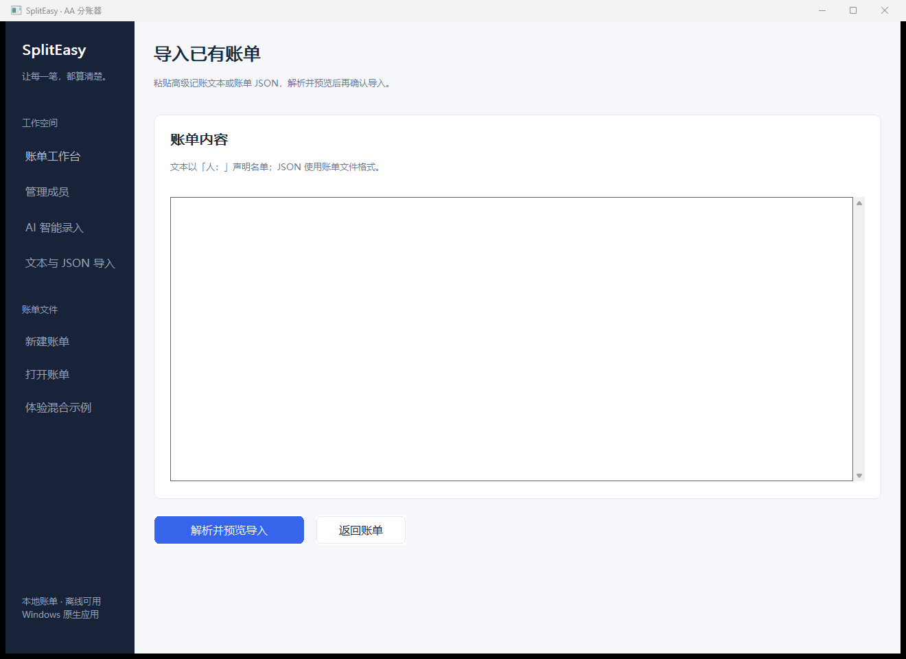

# 0.9.0 原生界面优化

本轮针对 0.8.0 的按钮密集、层级不清和报表拥挤，调整 Windows 原生桌面的布局与样式。计算算法、整数分、文件格式和 AI 两次确认保持原约定。

## 参考研究

只借鉴布局与交互思路，未复制第三方界面代码、品牌或图形素材。

| 项目 | 阅读入口 | 本项目采用的思路 |
| --- | --- | --- |
| Spliit | [仓库](https://github.com/spliit-app/spliit)、[消费列表](https://github.com/spliit-app/spliit/blob/main/src/app/groups/%5BgroupId%5D/expenses/expense-list.tsx) | 消费列表与余额分区，说明和金额分层，空状态说明下一步 |
| SplitPro | [桌面布局](https://github.com/oss-apps/split-pro/blob/main/src/components/Layout/MainLayout.tsx)、[消费记录](https://github.com/oss-apps/split-pro/blob/main/src/components/Expense/ExpenseList.tsx) | 桌面侧栏、独立主操作、记录标题/辅助信息/右侧金额 |
| Split-it | [桌面设计规划](https://github.com/kunmath/split-it/blob/main/plan.md) | 概览、消费和侧边摘要的多栏组织；窄窗口重排；录入信息分组 |

## 实现

- 深蓝侧栏、浅灰画布、白色卡片与蓝色主操作，统一圆角、间距和中文字体。
- 概览展示当前账单总额、人数和消费数；没有计算时不显示伪造余额。
- 桌面宽窗口左侧显示消费及完整报表，右侧显示转账清单和成员；较窄窗口把右侧卡片放到下方。
- 原生列表分开绘制名称、付款人/方式及金额，保留标准键盘选择和可访问文本。
- 统一结算和添加消费为主操作，复制/导出在结果无效时禁用。
- 消费表单分为付款信息和分摊明细，平均/实际金额共享控件与原来的校验。
- AI 服务配置、账单输入与确认预览使用相同主题，继续遮盖密钥、异步处理并保留两次确认。
- 窗口重排保留消费表单、AI 配置/输入、导入文本、成员输入和列表选择。
- 装饰由 C/Win32 绘制；页面组织、状态和数据仍由 MoonBit 管理，不使用网页或 WebView。

## 验证

- 本地固定工具链：`moon fmt --check`、`moon check --target native`，JS 核心 19 组通过。
- 原生 smoke 补充 800/1040/1320 宽度的控件横向边界、重排输入保留和过期结果禁用检查。
- Windows CI 保留全部核心、桌面、CLI、AI 模拟和安装卸载回归。
- 发行产物包含主界面、消费编辑、AI 输入、文本导入四张真实原生程序截图。
- CI 结果以本轮 PR 检查为准。真实模型与用户 Windows 10/11、输入法、不同实际 DPI 的人工验收仍待完成。

## 最终实际验证（2026-10-16）

[Windows CI 38853402455](https://github.com/William206920/Splict-easy/actions/runs/38853402455) 成功，源码提交 `12ddc99a1c5b42a08a81220c19b36d7098700d1c`。Native 21 组、全部桌面操作、800/1040/1320 实际窗口宽度、控件遮挡与输入保留、CLI 黄金、AI 本地模拟、安装/重复安装/卸载与用户数据保留均通过。

截图复核发现并修复了隐藏窗口未绘制、卡片遮挡子控件，以及较小显示器限制实际测试尺寸的问题。没有只以编译或几何尺寸检查代替截图复核；修复后四个页面均由 Codex 实际查看。键盘顺序仍按控件逻辑顺序，卡片保持在底层。真实用户桌面与真实模型仍未代验。

[下载验证包](https://github.com/William206920/Splict-easy/actions/runs/38853402455/artifacts/12026535125)，包含便携版、安装器、SHA256 与以下四张原生截图。文档和截图补录不改变已验证的应用代码。

### 账单工作台

### 消费编辑

### AI 录入

### 文本和 JSON 导入

