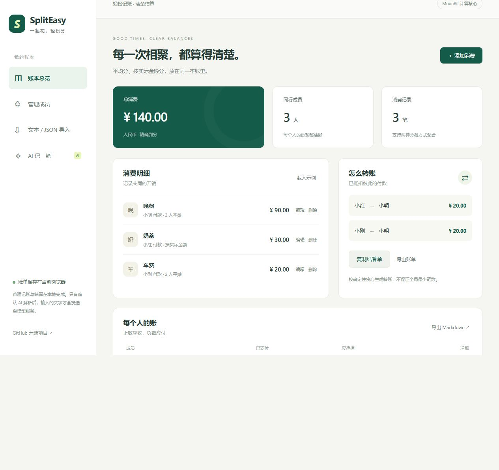

# Vercel 在线版

## 2026-10-20 实际部署与 Kimi 变更

用户已完成 Vercel 登录并授权 GitHub。PR #3 已合并到 `main`（`fcaeeed`），[Linux CI 39370235398](https://github.com/William206920/split-easy/actions/runs/39370235398) 与 [Windows CI 39370235388](https://github.com/William206920/split-easy/actions/runs/39370235388) 均通过。

正式网站：[https://spliteasy-online.vercel.app](https://spliteasy-online.vercel.app)。Vercel 项目为 `spliteasy1/spliteasy-online`，首次生产部署 `Eq5AqPjAgpJpRFhKd4KTcyfdPtai` 已显示 Ready，来源为 `main` 的 `fcaeeed`。公开首页返回 200，CSP 生效，API 状态接口正常。实际浏览器载入 140 元混合示例、确认预览、进入独立成员页并刷新恢复账单均通过。

用户随后将服务商改为 **Kimi**。当前建议配置为 `MOONBIT_BASE_URL=https://api.moonshot.cn/v1`、`MOONBIT_MODEL=kimi-k2.6`；`MOONBIT_API_KEY` 填 Kimi 开放平台的 Key，变量名不变。该模型按官方文档关闭思考模式、使用 `temperature=0.6` 和 JSON Mode，结果仍经 MoonBit 校验和用户确认。

官方依据：[快速开始](https://platform.kimi.com/docs/get-api-key)、[Kimi K2.6](https://platform.kimi.com/docs/guide/kimi-k2-6-quickstart)、[JSON 输出格式](https://platform.kimi.com/docs/guide/response_format)。原有 DeepSeek 支持保留为可选兼容，不代表当前生产配置。以下 2026-10-16 内容为历史准备记录；账号登录阻塞已解除。

### 生产 AI 已实际验收

- PR #4 已合并至 `8ee0ffb`，[Linux 网页 CI 39371384502](https://github.com/William206920/split-easy/actions/runs/39371384502) 和 [Windows 原生 CI 39371384323](https://github.com/William206920/split-easy/actions/runs/39371384323) 均通过；Node 网关/桥接回归增至 14 组。
- 用户提供的 Kimi Key 已保存为 Production 的服务端 Secret，未写入仓库或日志，交接用本地临时文件已清空。用户授权接受条款后，创建 `spliteasy-quota`，选择 Upstash **Free**（页面列出每月 500000 条命令），区域 `iad1`，未启用付费计划。连接生产/预览环境，使用敏感的 `KV_*` 变量。
- 重新部署 `DFJDHDSMgdBCCA14LU8anb87BNX8` 显示 Ready。公开 `/api/parse` 返回 `enabled: true`、`provider: api.moonshot.cn`、`model: kimi-k2.6`、`invitationRequired: false`。
- 真实浏览器用内置自然语言示例请求 Kimi，核对发送目标后确认。返回三人及晚餐 90 元、奶茶 30 元、车费 20 元的逐笔预览；确认替换后总计 140 元，小明应收 40 元，小红/小刚各应付 20 元，两笔转账分别为 20 元。刷新/另一标签页恢复账单仍正确。
- 真实公开 API 对“二人吃饭 100 元平摊，但忘了谁付钱”的输入返回 HTTP 422：`账单存在歧义：付款人是谁？`，没有可应用的账单。该项通过 HTTP 接口验证；浏览器自动化在后续弹窗处曾失去响应，未把该次浏览器尝试计为通过。
- 配置限制为每 IP 每小时 10 次、全站每天 100 次（UTC 日期）。这里只验证了真实服务可用；额度耗尽、上游故障等由自动回归覆盖，没有为了验收耗尽生产额度。该请求数限制不等同 Kimi 账户的金额预算。

上述是真实 **网页版** AI 验证；Windows 原生 GUI/CLI 的真实服务演示与用户桌面 DPI/输入法人工验收仍分别待完成。下文旧记录中的“未部署/未配置”仅反映 2026-10-16 状态。

2026-10-16 用户授权：保留 Windows 原生版，同时增加浏览器在线版，所有访客可使用维护者的 DeepSeek API。API Key 不得出现在源码、网页、浏览器存储、构建日志、截图或客户端包中。

## 架构

- `web/bridge/*.mbt` 导出 MoonBit 共享核心。所有金额转换、成员/消费增删改、名单规则、Int64 整数分、结算、AI 校验复用 `shared` 和 `ai`，不在 JavaScript 中重写分账算法。
- `web/bridge/browser.mbt`、`web_state.mbt`、`web_render.mbt` 实现浏览器控制、页面展示、成员/消费表单、草稿冲突和 AI 确认状态。`browser_io.mbt` 的短 JS FFI 仅提供 DOM、存储、文件与网络能力；`web/public` 保留 HTML/CSS 和两行启动入口。账单的整数分始终留在 MoonBit 内，不经 JavaScript `Number`，避免大整数精度损失。迁移与语言统计见 [LANGUAGE_AUDIT.md](LANGUAGE_AUDIT.md)。
- `api/parse.mjs` 是 Vercel Node.js Function。模型地址、Key、模型均只读取服务端环境变量，不接受客户端覆盖。默认公开使用，可切换为邀请码模式。
- 发送前勾选同意并再次确认 → 服务端限制额度 → Kimi → MoonBit 严格校验 → 返回逐笔预览 → 用户确认替换 → MoonBit 本地结算。AI 不负责计算净额。
- 普通账单保存在当前浏览器 `localStorage`，不会自动跨设备同步。损坏草稿保留备份路径，多标签冲突阻止覆盖。不要把“本地保存”等同永久可靠存储，提供 JSON/Markdown/文本导出。

## Vercel 项目配置

从 `William206920/split-easy` 导入项目；根目录为仓库根目录，Framework 选 Other，构建和输出由 `vercel.json` 定义。Node.js 22。Git 分支变更会触发 Vercel 构建。

Vercel 构建使用已检入的 MoonBit 编译产物 `web/generated/core.mjs`，不要求 Vercel 额外安装 MoonBit。构建先检查源文件指纹。GitHub CI 用固定工具链重新编译并检查生成文件一致，防止生成产物与 MoonBit 源码脱节。首次 Linux CI 发现 Windows/Linux 编译器对数字指数前导零的打印有差异（`1e+012` 与 `1e+12`）；在生成步骤仅规范数字 token 的指数，保留字符串/注释不变，并增加回归。没有跳过生成产物一致性检查。

在 Vercel 项目 Settings → Environment Variables 中填写：

| 变量 | 内容 |
| --- | --- |
| `MOONBIT_BASE_URL` | `https://api.moonshot.cn/v1`（2026-10-20 改用 Kimi） |
| `MOONBIT_MODEL` | `kimi-k2.6` |
| `MOONBIT_API_KEY` | 维护者自己的 Key，设置为敏感环境变量 |
| `UPSTASH_REDIS_REST_URL` | 持久化额度存储的 HTTPS REST 地址 |
| `UPSTASH_REDIS_REST_TOKEN` | 额度存储凭据，设置为敏感环境变量 |
| `SPLITEASY_ACCESS_MODE` | `public`（用户已选择公开） |
| `SPLITEASY_HOURLY_LIMIT` | 默认 `10`，每 IP 每小时 |
| `SPLITEASY_DAILY_LIMIT` | 默认 `100`，全站每天，按 UTC 日期 |

DeepSeek 官方文档说明 DeepSeek-V4.1-Flash 使用 API 模型名 `deepseek-flash`。服务端在官方域名下启用 JSON 输出，并关闭思考模式以缩短解析时间。来源：[首次调用](https://api-docs.deepseek.com/)、[JSON 输出](https://api-docs.deepseek.com/guides/json_mode/)、[思考模式](https://api-docs.deepseek.com/guides/thinking_mode/)。这是接口配置核对，不能代替真实调用验证。

额度存储可在 Vercel Marketplace 连接 Upstash Redis；只有在用户确认的免费额度/已有套餐内设置，不能未经授权购买服务。使用原子 Redis Lua 脚本跨实例限制每 IP 每小时与全站每天请求数。只存散列 IP 标识与计数，最长 48 小时失效，不存账单文字。无额度服务或存储故障时不发送模型请求；不以进程内 Map 冒称全局限流。失败/歧义模型请求仍占额度，取消浏览器请求也不保证上游停止计费。更换 Key 或额度命名空间会重置计数。请求数限额不是精确的货币预算，建议同时在模型账户设置可用额度。

额度配置同时接受 Vercel Marketplace 集成常见的 `KV_REST_API_URL` / `KV_REST_API_TOKEN` 别名。

环境变量仅在服务端使用。修改后需重新部署；没有配置完成时，网站普通分账可用，AI 显示未配置并返回 503。不得将用户提供的真实 Key 发到聊天或写进 `.env.example`。

## 本地构建与验证

```text
moon fmt --check
moon check --target native
moon test --target js
node scripts/build-web.mjs --compile
node --test tests/web.test.mjs
node scripts/serve-web.mjs
```

浏览器打开 `http://127.0.0.1:4173`。Node 22+；编译需使用 `toolchain.version` 固定的 MoonBit。

开发时如果需要环境变量，可使用 Node 的 `--env-file=.env.local`，该文件已忽略。不要把真实密钥放进命令行参数或日志。生成产物随源码提交；修改 MoonBit 后必须重新编译。

## 2026-10-16 历史验收状态

2026-10-16 本地实际验证：`moon fmt --check`、Native/JS 类型检查、MoonBit JS 20 组测试通过；新增 Node 浏览器桥接/HTTP 网关 13 组测试通过。原有混合黄金、0.29 尾差、大于 JS Number 安全范围的 Int64 金额往返、关联成员删除保护、无效导入、歧义、截断、额度与上游故障均验证。首次新测试发现根地址会产生双斜杠，已修复；新测试里录入错误的黄金期望已对照原有 shared/settle_wbtest.mbt 纠正，原有正确黄金与算法未变。

实际打开浏览器：独立成员页、添加成员、刷新恢复、实际份额合计不符阻断、正确保存、无效导入不覆盖；1280 与 390 像素视口下页面没有横向整体溢出。截图来自本地真实运行及示例数据，不是生产部署或真实 AI 证据。



[查看手机布局截图](screenshots/online-mobile.png)

源码提交 `8864afcc37a6d05fff5d2703f639ec4d39ec69b1` 的远端验证已完成：

- [Linux 网页 CI 38860175878](https://github.com/William206920/split-easy/actions/runs/38860175878) 通过：固定 MoonBit、20 组 JS 测试、重新编译后生成产物一致、Node 22 下 13 组网关/桥接测试与静态产物上传。
- [Windows 原生 CI 38860175899](https://github.com/William206920/split-easy/actions/runs/38860175899) 全部通过：原生构建、测试、GUI/CLI/模拟 AI 集成、安装包生成及安装验证。网页新增未破坏桌面交付。
- 本地代码与 GitHub `codex/vercel-online` 的 Git 树一致。开发变更见 [PR #3](https://github.com/William206920/split-easy/pull/3)。

生产部署尚未完成：Vercel 账号登录曾触发手机号尝试次数限制，需用户自行完成账号验证。2026-10-16 用户最终选择继续使用 Vercel；试验性的 Cloudflare 适配未发布，已撤回。不将这些本地测试或本地截图称为生产部署。

真实 DeepSeek Key 尚未配置，真实模型演示与真实额度存储仍待实际验证。不能用模拟上游响应替代真实服务验收。用户应在 Vercel 项目的敏感环境变量中设置密钥，后续重新部署并用示例账单完成端到端核对。

Windows 原生 GUI/CLI 不受该网页入口影响，依旧直接使用用户配置的兼容 API；本次没有宣称桌面端已经自动接入共享站点。
